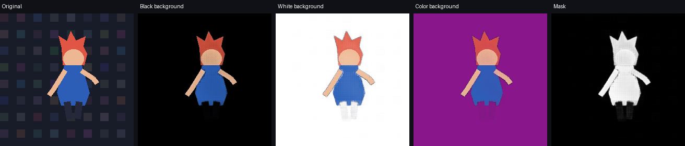
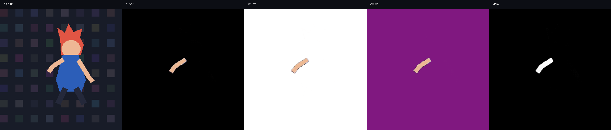
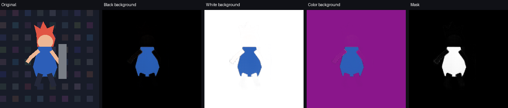

# SAM 2.1 Tiny — relatório de qualidade

## Decisão

**REPROVADO para o gate de integração.** Além das falhas nos ensaios sintéticos de 30 e 60 segundos, a primeira validação com o episódio fornecido perdeu completamente a máscara após uma mudança de plano. Uma correção por pontos no estado propagado não recuperou a máscara. O teste real cobre só um trecho de 3 segundos e não tem máscara de referência; não permite generalizar para todas as cenas ou declarar que SAM 2 é inadequado em geral, mas a qualidade necessária para integrar ainda não foi demonstrada.

Não houve alteração na interface, timeline, instalador ou código do produto nesta validação.

## Configuração

| Item | Configuração |
|---|---|
| Host | Windows; Ryzen 5 3600, 16 GB RAM, AMD Radeon RX 580 4 GB |
| Dispositivo de inferência | CPU; PyTorch `2.5.1+cpu`, `torch.cuda.is_available() == False` |
| TorchVision | `0.20.1+cpu` |
| Modelo | SAM 2.1 Hiera Tiny, checkpoint oficial `sam2.1_hiera_tiny.pt` |
| SHA-256 do checkpoint | `7402E0D864FA82708A20FBD15BC84245C2F26DFF0EB43A4B5B93452DEB34BE69` |
| Resolução e amostragem | 256×256, 1 quadro por segundo |
| Cenário | Animação vetorial sintética com máscara de referência gerada; não é anime |

O benchmark propagou a máscara para a frente e para trás a partir do quadro inicial. As medidas de IoU comparam a máscara prevista à máscara de referência sintética, não a uma anotação humana de anime. O processo carregou o modelo em 3,77 s; os tempos abaixo são por job e não incluem esse carregamento inicial.

## Resultados

| Duração sintética | Quadros | Tempo do job | Tempo/quadro | FPS processados | IoU média | IoU mínima | Quadros com IoU < 0,75 | `reviewFrames` |
|---:|---:|---:|---:|---:|---:|---:|---:|---:|
| 10 s | 10 | 41,684 s | 4,168 s | 0,240 | 0,8715 | 0,8506 | 0/10 | vazio |
| 30 s | 30 | 134,638 s | 4,488 s | 0,223 | 0,0635 | 0,0491 | 30/30 | vazio |
| 60 s | 60 | 301,461 s | 5,024 s | 0,199 | 0,4424 | 0,3807 | 60/60 | vazio |

Os três jobs consumiram cerca de 8 minutos no total. A RAM máxima observada pelo monitor externo foi **2.000,5 MiB** ao longo do conjunto; foram apenas 17 amostras irregulares, portanto isso é um máximo observado, não garantia do pico real nem um número por job. A GPU AMD não participou da inferência e não houve medição de VRAM.

O JSON bruto registra os resultados por job em [`sam2_synthetic_results.json`](./sam2-quality/sam2_synthetic_results.json). Os valores de memória por job foram substituídos por `null`: a medição disponível cobre o processo inteiro e não permite atribuir picos a cada duração.

## Comparações visuais

As imagens mostram o original, o recorte sobre preto, branco e roxo e a máscara. São quadros sintéticos, não exemplos de anime.

**Ensaio de 10 s, quadro 5:** o resultado visual ainda não preserva claramente as pernas escuras, apesar do IoU sintético alto. Isso demonstra que a métrica agregada não certifica detalhes de silhueta.



**Ensaio de 30 s, quadro-semente 15:** somente parte de um braço foi segmentada; o restante do personagem foi perdido.



**Ensaio de 60 s, quadro-semente 30:** a máscara retém principalmente o torso, sem a cabeça e os membros.



## Avaliação dos casos pedidos

O trecho real inclui close-up de rosto/cabelo no início, ação, uma troca de plano, roupa/partes do corpo em movimento e iluminação azul intensa, além de uma imagem posterior com explosão. Não cobre de forma controlada personagem parado, corrida contínua, oclusão claramente anotada ou movimento de câmera contínuo. Fios finos, mãos, consistência de identidade entre planos e qualidade com máscara de referência continuam sem validação.

O ensaio sintético continua sendo o único com ground truth, a 1 quadro/s. O ensaio real usa os 72 quadros decodificados a 24000/1001 fps, mas o modelo levou vários segundos por quadro em CPU. Nenhum resultado deve ser extrapolado para o episódio completo nem para processamento em tempo real. O protótipo limita jobs a 180 quadros.

O episódio foi fornecido pelo usuário e autorizado para processamento local; nenhum vídeo foi baixado ou adicionado ao repositório. A música `videoplayback.m4a` não foi usada: esta fase mede segmentação visual, não sincronização ou mixagem de áudio.

## Extensão nativa `_C`

No commit do SAM 2 fixado pelo projeto (`2b90b9f5ceec907a1c18123530e92e794ad901a4`), a extensão `_C` implementa **componentes conectados** para o preenchimento opcional de pequenos buracos nas máscaras:

1. `build_sam2_video_predictor` configura `fill_hole_area=8`.
2. `fill_holes_in_mask_scores` chama `get_connected_components` para identificar regiões do fundo (`mask <= 0`) conectadas em 8 direções, com área até o limite configurado, e ajusta seus scores para `0.1`. O preenchimento ocorre nos scores de máscara de baixa resolução antes do redimensionamento.
3. Se a importação de `sam2._C` falha, o código emite um aviso e ignora esse pós-processamento, mantendo os scores de máscara originais.

Esse código não implementa a segmentação principal nem o rastreador. A máscara ajustada é usada no estado/memória do predictor; portanto, buracos pequenos podem afetar a propagação seguinte, mas não há base para atribuir a falha grande dos ensaios a essa extensão. O ensaio foi executado sem `_C` e **não houve comparação A/B**.

O `setup.py` upstream constrói `_C` como `CUDAExtension` a partir de `sam2/csrc/connected_components.cu`; o kernel usa tensores/APIs CUDA. Não foi encontrada uma configuração upstream de compilação CPU/Windows para essa extensão. Nesta máquina não há CUDA, `nvcc` nem compilador compatível configurado. Não foram instalados componentes CUDA nem tentada uma compilação incompatível.

Alternativas CPU conhecidas para a operação de componentes conectados incluem `scipy.ndimage.label` e `cv2.connectedComponentsWithStats`. SciPy e OpenCV não estavam instalados no ambiente do benchmark e não foram adicionados nem comparados; integrar uma alternativa requer verificar conectividade, limite de área e equivalência do preenchimento com testes. A ausência de `_C` não impede o uso do SAM 2, mas remove esse preenchimento opcional.

Referências upstream:

- [SAM 2 — setup.py no commit fixado](https://github.com/facebookresearch/sam2/blob/2b90b9f5ceec907a1c18123530e92e794ad901a4/setup.py)
- [Kernel CUDA de componentes conectados](https://github.com/facebookresearch/sam2/blob/2b90b9f5ceec907a1c18123530e92e794ad901a4/sam2/csrc/connected_components.cu)
- [Utilitários de máscara e carregamento](https://github.com/facebookresearch/sam2/blob/2b90b9f5ceec907a1c18123530e92e794ad901a4/sam2/utils/misc.py)
- [Configuração do predictor de vídeo](https://github.com/facebookresearch/sam2/blob/2b90b9f5ceec907a1c18123530e92e794ad901a4/sam2/build_sam.py)

## Fase 2.2 — primeiro teste visual com o episódio fornecido (2026-11-09)

**Estado: teste real executado, mas cobertura parcial e gate reprovado.** A mídia estava na raiz de `C:\Users\Bruno\Videos\AMV-SAM2-Quality`, não em `originais`. Foi usado o venv isolado já verificado em `runtime\venv`; não foi instalado CUDA, alterado o instalador nem incluída mídia no Git.

### Execução e desempenho

| Medida | Resultado observado |
|---|---:|
| Fonte | `05. The Highest vs. The Lowest (1).mkv` |
| Trecho | 857,5–860,5 s |
| Resolução / taxa | 1280×720 / 24000/1001 fps |
| Quadros | 72 |
| Hardware / inferência | Ryzen 5 3600 / CPU; CUDA indisponível |
| Carregamento do modelo | 0,768 s |
| Propagação inicial (frente e trás) | 338,296 s |
| Média inicial | 4,699 s/quadro; 0,2128 quadro/s |
| Adição de correção e propagação para frente | 4,400 s + 170,504 s |
| Renderização das comparações | 13,884 s |
| Tempo total observado | 537,665 s |
| Pico de working set do processo | 2404,6 MiB |
| VRAM | não aplicável; CUDA indisponível e uso de VRAM não medido |

O SHA-256 dos pesos conferiu (`7402e0d864fa82708a20fbd15bc84245c2f26dff0eb43a4b5b93452deb34be69`); o runtime confirmou PyTorch `2.5.1+cpu`, CUDA indisponível e `_C` ausente. O aviso do upstream confirmou que o preenchimento opcional de buracos foi ignorado. A inferência e a exportação dos comparativos terminaram; houve uma falha de chamada no primeiro script de benchmark antes de iniciar a propagação, corrigida antes da execução contabilizada.

### Resultado visual e correção

- No quadro-semente, a máscara inicial cobre parte do rosto/cabelo do personagem, mas não valida fios finos ou bordas profissionais.
- A máscara some completamente em quadros amostrados após a troca de plano (quadros 18 e 36; área da máscara no quadro 36: 0). Mais adiante aparecem máscaras borradas/incompletas e vazamento em uma cena de combate com explosão.
- Foram adicionados dois pontos positivos e um negativo no quadro 36 do estado propagado e a propagação foi repetida. A área continuou em 0 e **nenhum pixel da máscara mudou**; portanto esse ciclo de correção não recuperou o personagem.
- Como controle separado, dois pontos positivos e um negativo numa inicialização nova e isolada do quadro 36 produziram uma máscara de 5,023% da imagem: visualmente são partes das pernas/roupa, não o personagem inteiro. Isso demonstra resposta a prompts em um quadro, mas não uma correção temporal confiável nem propagação útil depois da troca de plano.
- Não há anotação manual de referência; não foram calculados IoU/precisão visual quantitativa no episódio. O teste não executou a heurística `reviewFrames` do wrapper, portanto não há resultado dela para esta mídia.

Comparativos e medições estão fora do repositório, em:

```text
C:\Users\Bruno\Videos\AMV-SAM2-Quality\resultados\sam2_real_857_5_860_5\
  visual_comparison.png
  correction_before_after.png
  original_silent.mp4
  mask.mp4
  cutout_black.mp4
  cutout_white.mp4
  cutout_color.mp4
  prompts.json
  results.json

C:\Users\Bruno\Videos\AMV-SAM2-Quality\resultados\sam2_correction_validated\
  correction_frame36_before_after.png
  corrected_mask.mp4
  corrected_rgba_rgb_preview.mp4
  fresh_prompt_mask.png
  fresh_prompt_cutout_black.png
  fresh_prompt_results.json
  prompts.json
  results.json
```

### Cobertura ainda necessária

O teste foi de apenas 3 segundos e não substitui clipes separados para personagem parado, corrida/luta contínua, cabelo/roupa esvoaçante, oclusões, mudanças de câmera, cena escura e efeitos de luz. Para completar a avaliação, ainda são necessários trechos autorizados curtos que cubram esses casos e máscaras de referência em quadros selecionados. O resultado atual já é suficiente para não integrar SAM 2.1 Tiny como recorte confiável sem revisão.

## Falha da sinalização de revisão

`reviewFrames` ficou vazio nos três ensaios, inclusive quando **todos** os quadros de 30 s e 60 s tiveram IoU abaixo de 0,75. A heurística atual em `segmentation.py` olha para área relativa da máscara e mudanças abruptas dessa área; ela não mede confiança do modelo, qualidade da silhueta nem concordância com o objeto. Assim, máscaras incompletas mas com área plausível não são sinalizadas. Essa heurística não é suficiente para permitir que o usuário confie no resultado sem revisão.

## Próximos passos antes de reconsiderar o gate

1. Obter clipes curtos próprios ou autorizados e anotar máscaras de referência em quadros espaçados, cobrindo movimento, oclusão, cabelo/roupa, câmera, escuridão e luz.
2. Repetir com seleção por ponto, múltiplos pontos positivos/negativos e caixa; registrar as correções necessárias por trecho.
3. Melhorar o sinalizador de revisão para detectar perda de partes/objeto e deriva, sem depender somente da área da máscara.
4. Medir estabilidade em amostragem mais próxima do vídeo real, RAM de forma contínua e tempo por resolução; separar testes de `_C`/preenchimento CPU da qualidade do modelo.
5. Só então decidir se a qualidade justifica integrar a UI, timeline, preview e exportação.

## Limitações deste relatório

- O segmento real tem só 3 s e não possui máscara de referência; não há IoU nem medida quantitativa de precisão da segmentação de anime.
- As máscaras e a cena sintéticas são simplificadas; o resultado de IoU não substitui avaliação visual nem anotação humana real.
- Apenas uma execução por duração foi feita; não há intervalo de confiança nem teste de repetibilidade.
- `_C` não foi instalado; não houve comparação entre a extensão e um substituto CPU.
- O teste real cobre só um trecho e não representa todas as condições (oclusão, movimento contínuo de câmera, cabelo fino, cena parada/escura).
- O teste standalone não validou cancelamento de job, revisão manual de máscaras, UI, timeline, renderização transparente ou instalador.

## Recomendação

Não integrar SAM 2.1 Tiny como recorte automático confiável nesta fase. Mantê-lo apenas como baseline experimental: a seleção pontual num quadro isolado gerou uma máscara parcial, mas o rastreamento e a correção após a perda não atenderam ao uso pretendido. Antes de escolher o modelo do produto, comparar SAM 2.1 com ao menos uma alternativa de propagação em clipes contínuos anotados e separar explicitamente a avaliação de detecção de cortes de cena.
